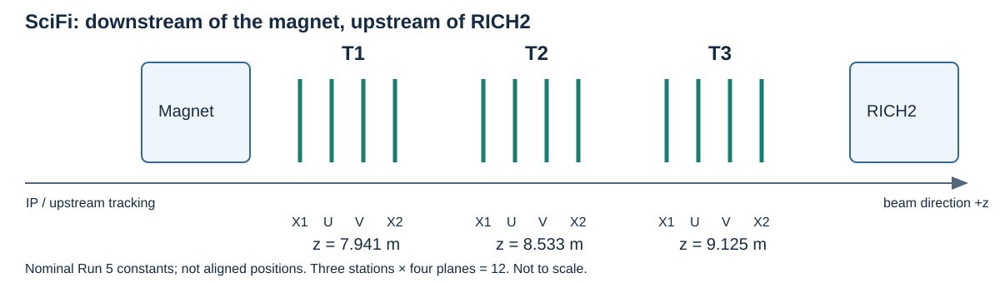
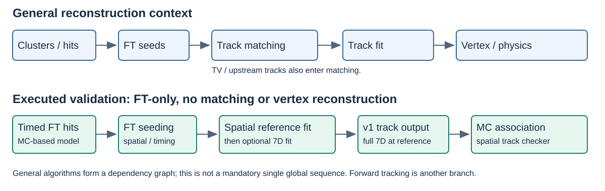

# SciFi seeding and a time-aware Kalman fit

## Detector → algorithms → implementation audit → performance

**Review date:** 12 November 2026  
**Scope:** SciFi-only reconstruction; TV tracking and matching are excluded from the implemented test.

- Detector statements: supplied **LHCB-TDR-015** and checked-out geometry code.
- Algorithm statements: checked-out Rec/LHCb/Moore source.
- Numbers: recorded 20-event runs on the supplied January **1.3e34** MC sample.
- Momentum, vertex and physics-selection improvements: **not yet demonstrated**.

<!--
Presentation use: each horizontal rule starts a candidate slide. HTML comments
are speaker/reviewer notes. Relative source links and SVG diagrams are local
assets. This is Marp-compatible Markdown, not a claim that a PDF slide export
has already been rendered. The seven numbered sections follow the requested
structure. Source definitions are collected at the end.
-->

---

# 1. SciFi position and structure



- TDR: three tracking stations **after the dipole magnet and before RICH2**.
- Each station has **X1–U–V–X2** detection planes: **12 planes in total**.
- Positive z follows the outgoing beam direction; y points upward.

Sources: [TDR §3.1, p.69 / PDF83][T69]; [§3.3, p.74 / PDF88][T74]; [Run 5 parameters][G1].

<!--
The diagram is newly drawn from these sources, not a scale drawing of the
whole LHCb detector. Station labels use nominal code constants, not alignment
results. The supplied PDF was published in 2014 and is not a Run 5 TDR.
-->

---

## 1.1. What a fibre plane measures

- X fibres are approximately vertical: their readout constrains **x**.
- U/V orientations provide stereo information; current code defines **U = −5°, V = +5°**.
- One cluster gives **one spatial measurement**, not independent x and y.
- Stereo measurements constrain combinations of x and y.

For an explanatory coordinate convention:

$$u_i \simeq x(z_i)+\alpha_i y(z_i).$$

**Actual fitting uses the fibre trajectory and its projection derivatives.**

Sources: [TDR §3.3][T74], [§3.3.1][T76]; [stereo constants][G1]; [FT measurement construction][C8].

<!--
alpha is a signed stereo coefficient for the chosen measurement convention;
do not identify its sign with the fibre rotation without following the code's
trajectory conventions. The Kalman implementation uses the geometric projector,
not this simplified formula literally.
-->

---

## 1.2. Physical fibre structure is not 12 independent y measurements

**2014 TDR description**

- Scintillating fibres: approximately **2.5 m long, 250 μm diameter**.
- SiPM readout at the top/bottom detector edges.
- Five/six stacked fibre sheets within a detection plane, depending on region.

**Current code**

- Geometry exposes stations → layers → half-layers/quarters → modules → mats.
- Run 5 constants still give **3 stations × 4 detection planes**.
- The configured channel pitch is **0.250 mm**; this is a readout parameter.

Sources: [TDR §3.1, p.70 / PDF84][T70]; [FT constants][G2]; [geometry builder][G3]; [parameters][G1].

<!--
Five/six physical fibre sheets within a mat must not be confused with the six
X detection planes or the twelve tracking planes. The historical 250 μm fibre
diameter and code's 250 μm channel pitch are different physical quantities.
-->

---

## 1.3. Historical TDR versus the geometry actually used

| Item | Source used for this study |
|---|---|
| Geometry selector | `run5/proto-v00.03-picocalfix` |
| FT component | `proto-run5-v00.01` |
| Nominal station z constants | T1 **7941 mm**, T2 **8533 mm**, T3 **9125 mm** |
| Spatial seeding reference | `ZMidT = 8520 mm` |
| Historical layout illustration | TDR Fig.3.4, p.75 / PDF89 |

The TDR drawing and module counts are **not the numerical Run 5 geometry**.
The Run 5 builder contains a Mighty Tracker geometry branch; do not assume the TDR's full SciFi coverage.

Sources: [geometry versions][G0]; [parameters][G1]; [builder][G3]; [StateParameters][C2]; [TDR Fig.3.4][T75].

<!--
The FT component selection is identical in proto-v00.03 and its picocalfix copy.
The latter changes PicoCal, not FT. The builder reads Tracker:includeMT and
changes the inner module construction and layer placement. The quoted z values
are XML constants before the full placement/alignment machinery.
The TDR's 20 mm gap and the code's layer pitches have different definitions;
this document deliberately does not equate them.
-->

---

# 2. Seeding: original spatial procedure

**Purpose:** find plausible FT hit combinations and provide initial T-track states.

```text
Raw FT banks → FTLiteClusters → spatial FT hits
    → XZ candidates → stereo association → full spatial seed fit
    → recovery / clone removal → seed hit IDs and states
```

- The baseline algorithm is `PrHybridSeeding`.
- It performs candidate search and small least-squares fits.
- It is **not** the subsequent Kalman fit.
- In this DIGI test, clusters are decoded from raw banks; the fitter does not perform clustering.

Sources: [raw-bank decoder][C14]; [spatial hit producer][C3]; [PrHybridSeeding::operator()][C4]; [seed model][C5].

---

## 2.1. Five spatial seeding parameters

With $d=z-z_{\rm ref}$:

$$x(z)=a_x+b_xd+c_xd^2(1+\rho d),\qquad y(z)=a_y+b_yd.$$

- Fitted parameters: $(a_x,b_x,c_x,a_y,b_y)$.
- $\rho$ (`dRatio`) is constrained/parameterized, not a sixth free coefficient.
- XZ fit: three parameters using X hits.
- YZ fit: stereo information with the current X estimate.
- Full XYZ fit: refine all five parameters using the selected X/U/V hits.

Sources: [AbsSeedTrack / SeedTrack][C5]; [XZ][C6a], [YZ][C6b], [XYZ][C6c] fitters.

<!--
The XYZ fitter updates the dRatio parameterization during its iterations.
Local Kalman tx is the derivative of this polynomial, not universally equal
to bx away from zref. The seed's cx is not literally q/p: the output conversion
uses the momentum estimate and local state representation.
-->

---

## 2.2. Candidate construction and rejection

1. Form X-layer combinations using station search windows and a parabola model.
2. Fit XZ and reject inconsistent X candidates/hits.
3. Collect U/V hits through the stereo/Hough search.
4. Fit YZ, then XYZ; apply hit-count, residual and χ² requirements.
5. Repeat configured cases; flag used hits, recover candidates and remove clones.
6. Output FT hit IDs and states, with a momentum estimate.

**Baseline ordering:** stereo association occurs within each seeding case.

Sources: [findXProjections, createXTrack, addStereo, RecoverTrack, makeLHCbTracks][C4].

<!--
This is the checked-out baseline flow, not a reconstruction of the 2014 TDR's
historical seeding implementation. In particular, PrHybridSeeding::operator()
uses main_loop with addStereo<icase> and flags full-track hits between cases.
-->

---

# 3. Seeding previous work: Jialu's timing study

- Attach a time to FT hits using linked MC hits and an explicit readout model.
- Add time-compatibility gates during candidate building and hit association.
- Fit a separate time line with two free timing parameters: intercept and speed/slope.
- Keep the spatial fit; timing can reject candidates without jointly refitting all spatial parameters.

$$t(z)\simeq t_{\rm ref}+\frac{(z-z_{\rm ref})\sqrt{1+t_x^2+t_y^2}}{v}.$$

**Merge request:** _to be inserted manually._

Sources: [jialu/Rec snapshot `4fc746677b`][J1]; [time-line fitter][J2].

<!-- Insert Jialu's merge-request link here. -->
<!--
Keep this section short in the presentation. At the inspected HEAD, the
baseline PrHybridSeeding and the timing variant are separate algorithms.
The timing flow runs three XZ passes, flags XZ hits, then a stereo stage; its
changes therefore extend beyond adding a timing veto to identical candidates.
The full-track timing veto in the inspected variant applies only below 11 hits;
not every seed receives that veto.
The port corrects the velocity normalization in the standalone time fitter:
x=(z-zref)*k implies fitted regression slope m=1/v, so v=1/m.
-->

---

# 4. Kalman fit: position in reconstruction



Sources: [matching and fitted-track wiring][M1]; [executed test sequence][V1].

<!--
The upper lane is contextual, not a claim that the test runs matching or
vertexing. Moore builds a dependency graph. TV tracks can themselves be fitted
before later matching; forward tracking is another route to long tracks.
The lower lane shows the actual validation and includes the spatial reference
fit required by the new 7D component.
-->

---

## 4.1. Why fit tracks after finding them?

| Necessity | Information produced or used |
|---|---|
| Momentum measurement | Refined $q/p$, covariance and consistency with field/material propagation |
| Vertexing | Positions, slopes and their correlations at useful reference surfaces |
| Following reconstruction/selections | Extrapolated states, uncertainties, track χ²; inputs to PID and candidate fits |

The TDR distinguishes **pattern recognition** from **parameter estimation**.
It attributes vertex precision mainly to early VELO measurements, and long-track momentum precision to upstream/downstream slopes and UT information.

Sources: [TDR §4.1.2, p.160 / PDF174][T160]; [§4.1.2.5, p.162 / PDF176][T162]; [§3.1][T69].

<!--
Kalman fitting does not itself reconstruct the physics decay vertex or apply
all later physics selections. Those are downstream consumers. Full long-track
benefits cannot be transferred quantitatively to the FT-only test: no TV
measurements or full magnet lever arm are added by fitting a seed.
-->

---

# 5. SciFi-relevant spatial Kalman algorithm

At a plane z:

$$\mathbf{s}_5=(x,y,t_x,t_y,q/p)^T,\qquad C_5\in\mathbb{R}^{5\times5}.$$

- The seed provides hit IDs and initial local states.
- The fitter reconstructs measurements from FT clusters and geometry.
- `TrackMasterFitter` coordinates nodes, reference updates and material effects.
- `TrackKalmanFilter` triggers filtering/smoothing; the numerical operations are in `FitNode`.

Sources: [configuration][M2]; [TrackMasterFitter][C7]; [FT provider][C8]; [TrackKalmanFilter][C10]; [FitNode][C11].

<!--
This is not Rec/Tr/PrKalmanFilter/KF.h. That is a separate fitter implementation.
The seed polynomial's five coefficients and the Kalman local state's five
components have different meanings.
-->

---

## 5.1. Nodes and the spatial measurement

- Measurement node: an FT fibre trajectory, uncertainty and reference z.
- Reference node: a requested state position, with no additional observation.
- The projector supplies $r_{\rm ref}$ and $H=\partial h/\partial\mathbf{s}$.

Explanatory local model:

$$u_i\simeq x_i+\alpha_i y_i,\qquad H_i\simeq(1,\alpha_i,0,0,0).$$

The real projector uses track–fibre closest approach; retain its full derivatives.

Sources: [makeNodes][C7]; [FTMeasurementProvider][C8]; [MeasurementProviderProjector][C9].

<!--
The existing FT measurement uncertainty is 0.04+0.01*pseudoSize mm in the
inspected provider. Seeding uses a different size-dependent error table.
These are pre-existing choices, not a measured timing-driven recalibration.
Nodes can be ordered in decreasing z; Forward means forward through that list.
-->

---

## 5.2. Prediction: transport the state and uncertainty

$$\mathbf{s}_i^-=F_i\mathbf{s}_{i-1}^++\mathbf{b}_i,$$
$$C_i^-=F_iC_{i-1}^+F_i^T+Q_i.$$

- $F_i$: Jacobian of field-dependent propagation.
- $\mathbf b_i$: offset of the local linearization.
- Mean energy loss changes momentum transport.
- $Q_i$: uncertainty from material effects, including scattering.

Sources: [updateTransport / updateMaterialCorrections][C7]; [computePredictedState][C11].

<!--
Prediction and process noise are different from measurement uncertainty R.
For FT-only tracks, the sensitivity to q/p depends on the actual field and
lever arm. updateTransport and TrackKalmanFilter can use four rather than five
effective spatial parameters when momentum is not constrained.
-->

---

## 5.3. Update: combine prediction with one hit

$$r_i=u_i-h(\mathbf{s}_i^-),\quad S_i=H_iC_i^-H_i^T+R_i,$$
$$K_i=C_i^-H_i^TS_i^{-1},\quad \mathbf{s}_i^+=\mathbf{s}_i^-+K_ir_i,$$
$$C_i^+=C_i^--K_iH_iC_i^-.$$

- $R_i$ is the measurement variance.
- A one-dimensional hit can change several correlated state components.
- For a scalar observation, the innovation contributes $r_i^2/S_i$ to χ².

Source: [computeFilteredState → LHCb::Math::Filter][C11].

<!--
These are explanatory Kalman equations. FitNode passes a reference state,
reference residual, projection matrix and measurement variance to the numerical
helper; the implemented residual is linearized around that reference.
-->

---

## 5.4. Smoothing, relinearization and outliers

- Forward/backward filtering provides information from both directions.
- The spatial fitter's bidirectional smoother combines compatible estimates.
- Outer iterations update reference states and recompute transport/projections.
- Inconsistent measurements may be removed, subject to hit requirements.
- Fit failure and a subsequent track-quality cut are separate operations.
- Existing Run 5 energy-loss correction includes an approximate **0.7 scale factor**.

Sources: [fit_r / outlierRemoved][C7]; [fit][C10]; [smoothing][C11]; [selection and energy-loss configuration][M2].

<!--
The inspected Run 5 wrapper has an approximate global energy-loss scale of 0.7.
This is not a result of the timing study and is not a validated material
calibration. It matters when interpreting parameter residuals.
The new test disables the spatial reference fitter's outlier removal for both
spatial-control and time-enabled cases; this is not every production default.
-->

---

# 6. Spatial + time Kalman algorithm: implemented extension

$$\boxed{\mathbf{s}_7=(x,y,t,t_x,t_y,v,q/p)^T}$$

- $t$: particle passage time at the local plane; $v$: independent fitted speed.
- Initial $v=c$ is a starting value, **not a constraint**.
- `SciFiTimeKalman` is an **opt-in FT-only algorithm**, not a global State API replacement.
- Spatial output states contain marginals; the complete reference 7D state/covariance is stored in track extra information.

Sources: [Gaudi component][N1]; [numerical core][N2]; [Moore helper][M2].

<!--
Code review command:
git -C Rec diff 999697530b6c86935b..HEAD -- Tr/TrackFitter/
The selected range excludes the initial seeding port. For that port, including
the time-line normalization correction, compare af1ab3f7e0..0bd33baedc. Later
source-compatibility changes in the broader diff are not the 7D filter itself.
The common LHCb State and generic extrapolators remain five-dimensional.
-->

---

## 6.1. What timestamps enter the fit?

The test producer explicitly generates

$$t_{\rm input}=t_{\rm MC}+\mathcal N(0,\sigma_t)+|y_{\rm MC}|/v_f,$$
$$\sigma_t=0.8\ {\rm ns},\qquad v_f=150\ {\rm mm/ns}.$$

- Source: linked MCHits in the supplied extended DIGI.
- This is not evidence of measured, already-smeared cluster timestamps.
- Multiple finite times for the same cluster ID: omit that cluster's time update.
- The fitter consumes hit timestamps, not MCParticle truth.

Sources: [PrStoreSciFiTimeHits][N3]; [FTLiteCluster representation][C1]; [timing lookup][N1].

<!--
The separate MC producer is the only truth-based part of this timing input.
It can retain two candidate times for a cluster, following Jialu's selection.
The v1 fit input no longer retains which candidate index seeding used, so the
fitter conservatively treats such IDs as ambiguous. It is not a full
multi-hypothesis timing association algorithm.
-->

---

## 6.2. Local measurement model: two observations, two rows

$$\mathbf m_i=\begin{pmatrix}u_i\\t_{\rm input,i}\end{pmatrix},\quad
h(\mathbf s_i)=\begin{pmatrix}h_u(\mathbf s_i)\\t_i+\tau(y_i)\end{pmatrix},\quad
\tau(y_i)=|y_i|/v_f.$$

For the simplified spatial convention:

$$H_i\simeq\begin{pmatrix}
1&\alpha_i&0&0&0&0&0\\
0&\operatorname{sgn}(y_i)/v_f&1&0&0&0&0
\end{pmatrix},\quad
R_i=\begin{pmatrix}\sigma_{u,i}^2&0\\0&\sigma_t^2\end{pmatrix}.$$

The code copies the real spatial projection and performs two scalar updates.
With corrected passage times, `FibreSpeed=0` removes the delay term.

Sources: [spatial projection construction][N1]; [fit / update][N2].

<!--
There is no measurement x+alpha*y+t. Position and time have different units.
The local velocity derivative in H is zero because t is already defined at
this plane; velocity influences the prediction through F. The derivative of
absolute y is piecewise; physical readout boundaries require geometry handling.
Sequential updates assume independent spatial/time measurement noise and use
the same linearization within a pass.
-->

---

## 6.3. Time transport and process noise

Using endpoint path factors $k=\sqrt{1+t_x^2+t_y^2}$:

$$L_{ij}\simeq\Delta z\,(k_i+k_j)/2,\quad t_j=t_i+L_{ij}/v_i,\quad v_j=v_i.$$

$$F_{t,t}=1,\qquad F_{t,v}=-L_{ij}/v_i^2,\qquad
F_{t,a}=\frac{1}{v_i}\frac{\partial L_{ij}}{\partial a}.$$

- Signed $\Delta z$ handles reversed node ordering.
- Spatial transport uses the existing extrapolator and energy-loss convention.
- The spatial $Q$ block is copied from the reference fit; timing $Q$ starts at zero.
- Constant velocity and trapezoidal path length are explicit approximations.

Sources: [timeTransport][N2]; [transport/noise embedding][N1].

<!--
A zero timing-Q block does not mean zero time uncertainty: C is transported and
measurements have R. Material effects on velocity/path-length fluctuations are
not fully modelled. The copied material noise is not recomputed after every
7D trajectory update. The timing derivatives also use the spatial transport's
slope sensitivity, including q/p where present.
-->

---

## 6.4. Update, smoothing and initialization

- Build a spatial reference with `TrackMasterFitter`, with spatial outlier removal disabled.
- Start a broad 7D prior; do not use the prefit posterior covariance as another measurement.
- Use Joseph covariance updates and **RTS smoothing**.
- Reset the same prior when relinearizing; default: **four passes** per retained measurement set.
- Permit two timing-only outlier removals, retaining at least three timed observations.

$$C^+=(I-KH)C^-(I-KH)^T+KRK^T.$$

Sources: [initialization / iteration / outlier loop][N1]; [update / fit][N2]; [reference-fitter configuration][M2].

<!--
Prior standard deviations in state order are (20 mm,20 mm,1000 ns,0.1,0.1,
1000 mm/ns,0.01 in q/p units). These are configuration/model choices, not
measured resolutions. Data-derived reference means with broad priors follow
the existing initialization pattern; exact prior-insensitivity is not yet tested.
The new smoother is RTS, whereas the spatial implementation has its own
bidirectional/classical options. Default four-pass execution has no explicit
convergence test based on delta chi2 or parameter shifts.
Timing outliers use the smoothed biased residual variance R-H*C_s*H^T, threshold
9, and keep the spatial measurement of the cluster. The minimum is a count of
timed observations, not an explicit rank/distinct-z test.
-->

---

## 6.5. Output and rejection contract

| Output/decision | Implemented behavior |
|---|---|
| Full 7D posterior | Reference z: key 61000; state: 61010+a; covariance: 61100+a(a+1)/2+b |
| Ordinary states | Spatial marginals at nodes; common five-dimensional API unchanged |
| Quality | Joint space–time χ²; spatial effective parameter count + two timing parameters |
| Missing timing | Fewer than three usable times → spatial fallback |
| Failed fit | Reject; count separately from fallback and timing-hit removal |

**Generic v1→future conversion does not preserve the experimental 7D metadata.**

Sources: [output / checks][N1]; [converter][C12]; [schema details][D1].

<!--
Schema key 61002 equals 1 on timed output; 61001 counts retained times. v must
be positive; non-finite states and non-positive/non-finite diagonal variances
are rejected. The output checks do not constitute a full SPD proof of every
smoothed covariance. Old KalmanFitResult is cleared because its cached residuals
and covariances belong to the spatial prefit. FitTChi2/FitTNDoF become joint-fit
quantities: existing spatial selection thresholds need validation before reuse.
Reference z is the first filtering node, not automatically ZMidT or the first
state in the sorted output vector.
-->

---

## 6.6. Detector-model audit: closure is not physical calibration

| Supplied TDR | Present test model |
|---|---|
| Photon arrival includes spillover, particle flight, scintillation and propagation | MC passage time + Gaussian + $|y|/v_f$ |
| Propagation uses distance from hit to SiPM; reflected paths are longer | Uses absolute global y |
| Illustrative propagation: 6.0 ns/m | 150 mm/ns ≈ 6.67 ns/m |

**Agreement between generator and fitter establishes toy-model closure only.**
Actual Run 5 readout geometry, offsets, scintillation response and timing resolution still require validation.

Sources: [TDR time model, p.150 / PDF164][T150]; [readout locations][T70]; [mirror/SiPM geometry][G4]; [producer][N3]; [prediction][N2].

<!--
For direct readout at an outer edge Yro and a mirror near the centre, the
geometric distance resembles Yro-|y|, not |y|, under the simple symmetric
coordinate convention. Do not silently equate the two: their coordinate
slopes can have opposite signs. The Run 5 DeFT geometry explicitly constructs mirrorPoint and sipmPoint
from opposite local-y ends of a mat. It does not derive propagation distance
from absolute global y alone. Follow each transformed fibre/readout placement
before changing the model. The 2014 TDR value is not a calibration
measurement for the current Run 5 hardware.
The seed time-line intercept includes the input delay, whereas the 7D state's
t is explicitly particle passage time. They cannot be compared without putting
both on the same time convention and reference plane.
-->

---

## 6.7. What is checked, and what is still open?

| Check | Evidence / status |
|---|---|
| 7D state mapping, Joseph update, scaled inversion | Implemented; numerical tests |
| Time transport derivatives, reverse propagation, free v | Tested on synthetic tracks |
| Smoothing and timing/velocity pulls | 128 noisy synthetic tracks |
| Real event integration, failure/fallback counters | Four completed 20-event configurations |
| Detector timing response, all coupled Jacobians, joint χ² calibration | **Not established** |
| Material timing noise, iteration convergence, realistic pull coverage | **Not established** |

Sources: [test source][N4]; [CTest log][V2]; [recorded event results][V3].

<!--
The derivative test exercises tx,ty,v with simplified endpoint behavior; it
is not a finite-difference audit of the complete detector/extrapolator chain.
The synthetic coverage test does not establish real-sample momentum or timing
coverage. Effective degrees of freedom are inherited from the spatial reference
plus two; the rank of the full coupled fit has not been measured independently.
Passing finite-variance checks does not certify convergence or calibrated errors.
-->

---

# 7. Kalman performance: what was actually compared?

**Provided MC sample used:** January MINBIAS **1.3e34**, slot 9, first **20 events**.

```text
/eos/lhcb/wg/rta/WP6/UII/Jan2026/MINBIAS/1p3E34/
MINBIAS_proto-v00.03_L1p3E34_Slot_9-30000000-100ev-20260129-Extended.digi
```

- Geometry: `run5/proto-v00.03-picocalfix`; FT and Magnet in the detector list.
- Local copy used after ROOT failed to open the direct EOS path; checksum matches.
- Timing is MC-derived with explicit 0.8 ns smearing and fibre delay.
- The supplied `tdr_u2_august2026` scenarios **were not used**.

Sources: [test job][V1]; [configurations, logs and sample checksum][V3].

<!--
No detector timestamp resolution is inferred just from a directory name.
The newer production scenarios have different geometry and are not a drop-in
input replacement. The ROOT/EOS failure was reproduced outside Gaudi; the
local and source files have SHA-256
5c185cfbf681dd6e03950bf0843adb414f8c1e13df9e7d38c6d3c1c8af26c58f.
-->

---

## 7.1. Selection proxies and reconstruction survival

| Configuration | Input seeds | Output tracks | Ghost rate | Long FT efficiency |
|---|---:|---:|---:|---:|
| Spatial seeding + spatial fit | 6873 | 6873 | 25.74% | 89.00% |
| Timing seeding only | 4610 | 4610 | 2.65% | 80.25% |
| Timing seeding + spatial fit | 4610 | 4610 | 2.65% | 80.25% |
| Timing seeding + 7D fit | 4610 | 4569 | 2.41% | 80.05% |

**The fit comparison is the last two rows: same timing seeding and same events.**
The first-to-last difference also changes seeding flow and candidate selection.

Sources: [final logs and summary][V3].

<!--
Ghost means unassociated under the configured MC association, not a universal
physics-background label. Long FT efficiency is the checker's truth-category
ratio, not a count of reconstructed TV+FT long tracks. MC links are rebuilt
from the final dense future container after filtering, so rejected v1 keys
cannot be misinterpreted as dense indices.
All four cases use the timed hit producer, including its overlapping-MCHit
behavior. The first row is thus a spatial algorithm control on that hit input,
not a statement that every stock production setup has 25.74% ghosts.
-->

---

## 7.2. Necessity axis 1: momentum measurement

| Before / after question | Current evidence |
|---|---|
| Does $q/p$ resolution improve? | **Not measured** |
| Does momentum bias or charge-flip rate improve? | **Not measured** |
| Are momentum covariance/pulls calibrated? | **Not measured on the MC sample** |

A correct comparison needs the **same matched tracks**, the **same reference surface**, and momentum truth at that surface:

$$\delta_p=(p_{\rm fit}-p_{\rm truth})/p_{\rm truth},\qquad
\mathrm{pull}_{q/p}=\frac{(q/p)_{\rm fit}-(q/p)_{\rm truth}}{\sigma_{q/p}}.$$

Sources: [current checker implementation][C13]; [available resolution-checking helper][M2].

<!--
PrTrackCounterFuture's P_reconstructed histogram is filled from
part->momentum().P(): it is a distribution of true momenta of reconstructed
particles, not a momentum residual. It cannot establish resolution improvement.
Use common-survivor comparisons plus full-population efficiency/tails to avoid
selection bias from removing the 41 failed fits. Separate charge mistakes and
momentum bins. A free v supplies no beta(p,m) mass hypothesis. Possible coupling
through path length/fibre delay is a mechanism, not measured improvement.
-->

---

## 7.3. Necessity axis 2: vertexing

| Before / after question | Current evidence |
|---|---|
| Primary/secondary vertex resolution | **No vertex reconstruction in these runs** |
| Track-to-PV association | **Not measured** |
| IP / flight-distance significance | **Not measured** |

SciFi passage time alone does not separate production time and production position:

$$t_{\rm ref}\simeq t_{\rm origin}+L(z_{\rm origin}\to z_{\rm ref})/v.$$

An external origin/vertex constraint and validated transport are needed before claiming a vertex-time benefit.

Sources: [TDR parameter-resolution discussion][T162]; [FT-only test][V1]; [time-state convention][N1].

<!--
The TDR identifies the first VELO measurements as dominant for vertex precision.
We intentionally skip TV reconstruction. FT-only back-extrapolation is not a
replacement demonstration of high-precision vertexing. For decay tracks, the
production vertex can be displaced from the primary vertex; the appropriate
flight history and hypotheses must be specified in any future timing test.
-->

---

## 7.4. Necessity axis 3: following processes and selections

**Measured fit-stage effects, holding timing seeding fixed:**

- 41/4610 fits rejected: **0.89%**.
- Ghosts: **122 → 110**; associated tracks: **4488 → 4459**.
- Long FT truth-category efficiency: **2735/3408 → 2728/3408**.
- High-momentum category: **1221/1446 → 1218/1446**.

**Not executed:** physics candidate building, mass fits, vertex cuts, PID or timing-based physics selections.
Existing spatial χ² thresholds cannot automatically be reused for a joint space–time χ².

Sources: [time_spatial log][V4]; [time_7d log][V5]; [quality-field output][N1].

<!--
The loss of 29 associated tracks is not evidence that the fitter removed only
background. The high-momentum row uses the checker's true p>5 GeV category;
it is not a measurement of fitted momentum resolution. A physics selection
study needs matched signal/background samples and efficiency at a specified
background rate, plus mass/vertex/time observables and calibrated uncertainties.
-->

---

## 7.5. Timing diagnostics are not yet physics-resolution results

| Quantity | Observed |
|---|---:|
| Successful timed fits / spatial fallbacks | 4569 / 0 |
| Retained time observations on successful fits | 44,295 |
| Removed time observations counter | 349 |
| Mean fitted speed | 309.70 mm/ns |
| Mean reported time error at stored reference | 1.8585 ns |

Failures: **35 invalid velocity**, **5 invalid posterior state/covariance**, **1 singular covariance**.

**A mean error bar is not a measured time resolution; a mean speed near c is not a velocity-calibration test.**

Sources: [event counters][V5]; [diagnostic failure counts][V6]; [counter placement][N1].

<!--
The reference plane is not necessarily the SciFi midpoint. To quote resolution
there or at the origin, transport the full correlated covariance and compare
with appropriate truth. Free fitted velocities can exceed c because there is
no upper-speed constraint; this does not by itself measure a physical beta.
The removed-times counter increments during attempts, including a track that
might fail later. Do not add 349 to 44,295 and interpret the sum as an exact
initial-observation count for the successful output population.
-->

---

## 7.6. Review verdict and next evidence needed

| Claim | Verdict from the present evidence |
|---|---|
| Port Jialu's timing seeding and run it | **Implemented; event integration checked** |
| Implement a coupled FT-only 7D filter | **Implemented; numerical and integration checks** |
| Replace the common State API / deploy 4D vertexing | **Not done** |
| Improve momentum resolution | **Not demonstrated** |
| Improve vertex resolution or PV association | **Not demonstrated** |
| Improve downstream physics selections | **Not demonstrated** |

Next: validate the readout model, full Jacobians/convergence/covariance coverage, then make controlled momentum, vertex and physics-selection comparisons.

<!--
This is a prototype validation verdict, not blanket certification that every
physical assumption and implementation detail is correct. The review should
focus especially on the |y| readout convention, frozen material noise, absent
timing process noise, fixed iteration count, effective degrees of freedom,
metadata preservation, and the observed failed fits.
-->

---

## 7.7. Reproduce and inspect the evidence

```bash
# After the initial Jialu seeding port: all later Rec changes
git -C Rec diff 999697530b6c86935b..0bd33baedc

# Concentrate on the new Kalman code
git -C Rec diff 999697530b6c86935b..0bd33baedc -- Tr/TrackFitter/

# Registered numerical test
Rec/build.x86_64_v3-el9-gcc15-opt/run ctest \
  --test-dir Rec/build.x86_64_v3-el9-gcc15-opt/Tr/TrackFitter \
  --output-on-failure
```

For an event run, enter a case directory under `run5_time_validation/` and use its JSON configuration. Restore the local sample cache first if needed.

Sources: [validation report][V3]; [implementation / reproduction guide][D1].

---

## 7.8. Source snapshot and review map

| Repository | Reviewed revision |
|---|---|
| Detector | `ebd2fadd557d8b56cb9a36f33219bfc51a081995` |
| LHCb | `1839001f6b1fdc54baa41c5ea881e03b3a07f9a2` |
| Rec | `0bd33baedc` |
| Moore | `3838469257` |
| Jialu Rec source | `4fc746677b` |

- Detector: [version selector][G0], [parameters][G1], [constants][G2], [builder][G3].
- Seeding: [baseline][C4], [seed model][C5], [Jialu variant][J1].
- Spatial fit: [master][C7], [provider][C8], [projector][C9], [nodes][C11].
- New fit: [component][N1], [numerical core][N2], [tests][N4]; [spatial reading guide][D2].
- Results: [logs, counts, checksum and revisions][V3].

<!--
The PDF page numbers in citations are one-based PDF viewer indices. Its main
text printed page number is PDF index minus 14. The supplied document is
LHCB-TDR-015 (2014), 210 PDF pages. Numeric performance in this deck is taken
from local Run 5 logs, not historical TDR performance tables.
-->

[T69]: LHCB-TDR-015.pdf#page=83
[T70]: LHCB-TDR-015.pdf#page=84
[T74]: LHCB-TDR-015.pdf#page=88
[T75]: LHCB-TDR-015.pdf#page=89
[T76]: LHCB-TDR-015.pdf#page=90
[T150]: LHCB-TDR-015.pdf#page=164
[T160]: LHCB-TDR-015.pdf#page=174
[T162]: LHCB-TDR-015.pdf#page=176
[G0]: ../Detector/compact/run5/proto-v00.03-picocalfix/versions.xml
[G1]: ../Detector/compact/components/FT/proto-run5-v00.01/parameters.xml
[G2]: ../Detector/Detector/FT/include/Detector/FT/FTConstants.h
[G3]: ../Detector/Detector/FT/src/FT_geo.cpp
[G4]: ../Detector/Detector/FT/src/DeFT.cpp
[C1]: ../LHCb/Event/FTEvent/include/Event/FTLiteCluster.h
[C2]: ../LHCb/Event/TrackEvent/include/Event/StateParameters.h
[C3]: ../Rec/Pr/PrAlgorithms/src/PrStoreSciFiHits.cpp
[C4]: ../Rec/Pr/PrAlgorithms/src/PrHybridSeeding.cpp
[C5]: ../Rec/Pr/PrAlgorithms/src/PrHybridSeedTrack.h
[C6a]: ../Rec/Pr/PrAlgorithms/src/PrTrackFitterXZ.h
[C6b]: ../Rec/Pr/PrAlgorithms/src/PrTrackFitterYZ.h
[C6c]: ../Rec/Pr/PrAlgorithms/src/PrTrackFitterXYZ.h
[C7]: ../Rec/Tr/TrackFitter/src/TrackMasterFitter.cpp
[C8]: ../Rec/Tr/TrackTools/src/FTMeasurementProvider.cpp
[C9]: ../Rec/Tr/TrackTools/src/MeasurementProviderProjector.cpp
[C10]: ../Rec/Tr/TrackFitter/src/TrackKalmanFilter.cpp
[C11]: ../Rec/Tr/TrackFitEvent/src/FitNode.cpp
[C12]: ../Rec/Pr/PrConverters/src/fromV1TrackFutureTrack.cpp
[C13]: ../Rec/Pr/PrMCTools/src/PrTrackCounterFuture.cpp
[C14]: ../LHCb/FT/FTDAQ/src/FTRawBankDecoder.cpp
[J1]: ../jialu/Rec/Pr/PrAlgorithms/src/PrHybridSeedingTiming.cpp
[J2]: ../jialu/Rec/Pr/PrAlgorithms/src/PrSciFiXZTimeFit.h
[M1]: ../Moore/Hlt/RecoConf/python/RecoConf/upgrade2_reconstruction.py
[M2]: ../Moore/Hlt/RecoConf/python/RecoConf/upgrade2_track_fitting.py
[N1]: ../Rec/Tr/TrackFitter/src/SciFiTimeKalman.cpp
[N2]: ../Rec/Tr/TrackFitter/src/SciFiTimeKalman.h
[N3]: ../Rec/Pr/PrAlgorithms/src/PrStoreSciFiTimeHits.cpp
[N4]: ../Rec/Tr/TrackFitter/tests/test_SciFiTimeKalman.cpp
[D1]: SCIFI_TIME_IMPLEMENTATION.md
[D2]: SCIFI_SPATIAL_KALMAN_READING_GUIDE.md
[V1]: run5_scifi_time_kalman_test.py
[V2]: run5_time_validation/core_test.log
[V3]: run5_time_validation/VALIDATION_REPORT.md
[V4]: run5_time_validation/time_spatial/log.txt
[V5]: run5_time_validation/time_7d/log.txt
[V6]: run5_time_validation/time_7d/debug_failure_counts.json
