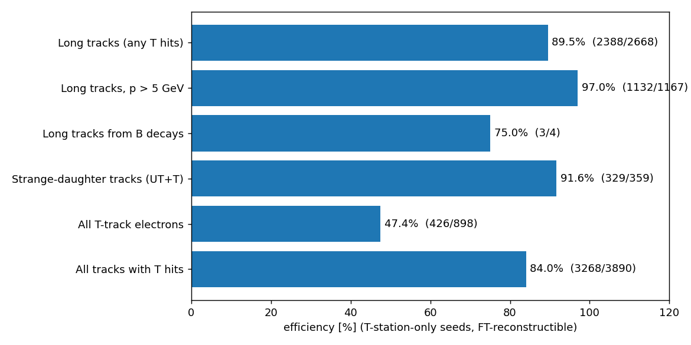
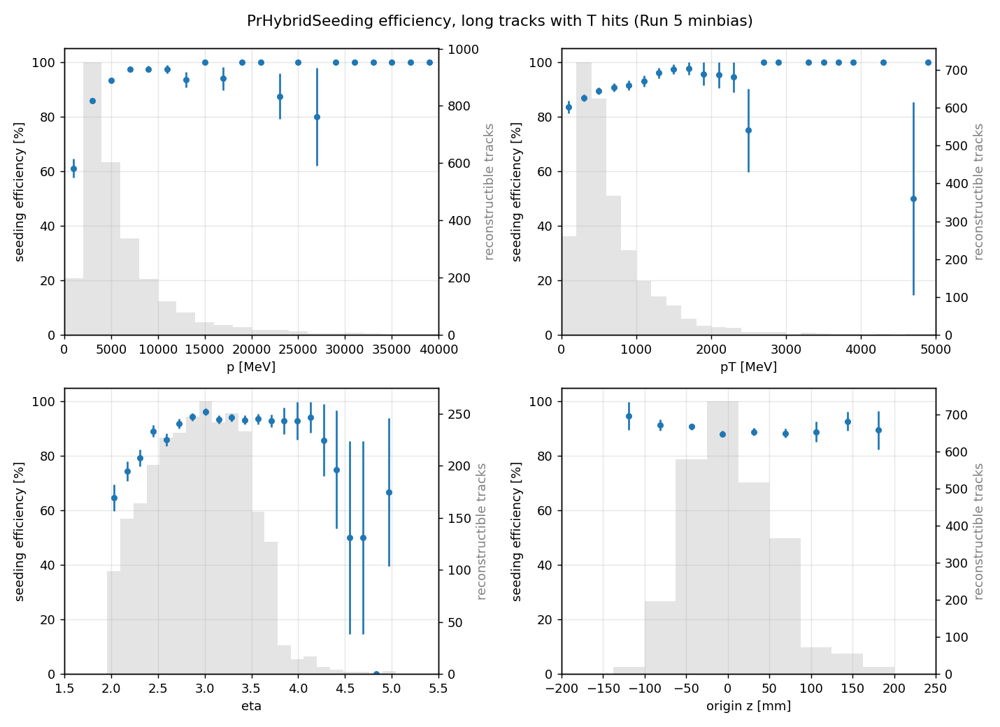

# SciFi seeding report (PrHybridSeeding, Run 5)

**Reconstructed seeds:** 4723, of which **643 ghosts (13.6 %)**, event average 11.1 %.

| Category | Found / reconstructible | Efficiency | Clones | Purity | Hit eff. |
|---|---|---|---|---|---|
| Long tracks (any T hits) | 2388 / 2668 | 89.5 % | 0 (0.0 %) | 99.4 % | 96.9 % |
| Long tracks, p > 5 GeV | 1132 / 1167 | 97.0 % | 0 (0.0 %) | 99.4 % | 98.4 % |
| Long tracks from B decays | 3 / 4 | 75.0 % | 0 (0.0 %) | 100.0 % | 100.0 % |
| Strange-daughter tracks (UT+T) | 329 / 359 | 91.6 % | 0 (0.0 %) | 99.2 % | 95.9 % |
| All T-track electrons | 426 / 898 | 47.4 % | 0 (0.0 %) | 99.2 % | 92.2 % |
| All tracks with T hits | 3268 / 3890 | 84.0 % | 0 (0.0 %) | 99.2 % | 95.9 % |

Rows use the `_FT` variant of each category (tracks reconstructible in the SciFi alone).

